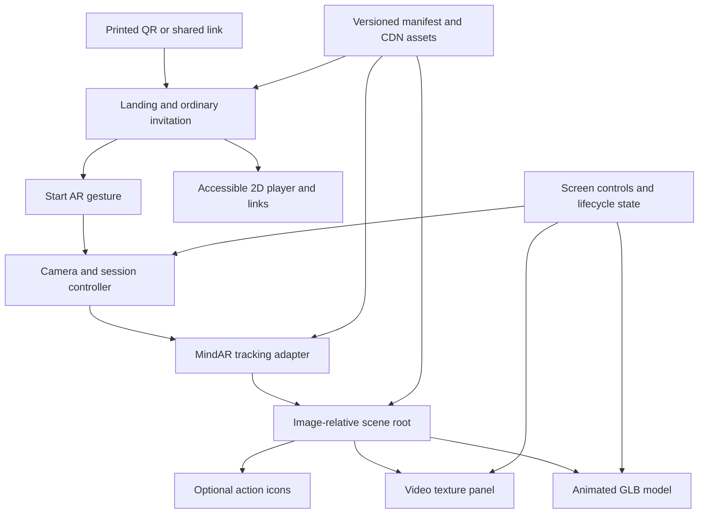

# AR Invite — WebAR Product Requirements Document

**Version:** 1.0 — detailed planning baseline  
**Prepared:** 2 November 2026, Asia/Kolkata  
**Status:** Proposed specification; WebAR approach selected by the product owner  
**Project:** `G:\Projects\AR Invite`  
**Product owner:** Project owner; individual name to be recorded  
**Delivery model:** Mobile browser experience using MindAR and Three.js

**Interface override — 2 November 2026:** The owner's subsequent implementation instruction replaces the proposed marketing/preview landing experience with a single Start button, followed by an edge-to-edge camera scanner. Keep only a small exit control and necessary scanning, error, and playback prompts. The prior requirements for promotional landing content, a scene preview, and a visible ordinary-player flow are superseded by this explicit direction; retain other applicable tracking, media, privacy, and lifecycle requirements. Browser fullscreen is optional enhancement; filling the available viewport is required on every supported browser.

> A guest opens a link, allows the camera, points it at an invitation, and sees animated 3D content and a video arranged around the printed image. Essential invitation information remains available without AR.

This document specifies the product to build. It does not claim that tracking, browser compatibility, performance, or a deployed experience has already been verified. Numerical budgets and success thresholds below are proposed release targets unless explicitly marked as observations.

## Contents

1. [Product summary and evidence](#1-product-summary-and-evidence)
2. [Goals, outcomes, and success measures](#2-goals-outcomes-and-success-measures)
3. [Users and jobs to be done](#3-users-and-jobs-to-be-done)
4. [Release scope and priorities](#4-release-scope-and-priorities)
5. [Guest journeys](#5-guest-journeys)
6. [Screens, controls, and copy](#6-screens-controls-and-copy)
7. [Functional requirements](#7-functional-requirements)
8. [Scene composition and visual behavior](#8-scene-composition-and-visual-behavior)
9. [Runtime states and lifecycle](#9-runtime-states-and-lifecycle)
10. [Video, audio, and animation rules](#10-video-audio-and-animation-rules)
11. [Target artwork and print production](#11-target-artwork-and-print-production)
12. [Content and asset specifications](#12-content-and-asset-specifications)
13. [Configuration and content model](#13-configuration-and-content-model)
14. [Technical architecture](#14-technical-architecture)
15. [Browser and device support](#15-browser-and-device-support)
16. [Performance and reliability](#16-performance-and-reliability)
17. [Accessibility and responsive behavior](#17-accessibility-and-responsive-behavior)
18. [Privacy, security, and content rights](#18-privacy-security-and-content-rights)
19. [Measurement and diagnostics](#19-measurement-and-diagnostics)
20. [Failure and recovery requirements](#20-failure-and-recovery-requirements)
21. [Verification and acceptance plan](#21-verification-and-acceptance-plan)
22. [Delivery phases and release gates](#22-delivery-phases-and-release-gates)
23. [Publishing, operations, and maintenance](#23-publishing-operations-and-maintenance)
24. [Dependencies, risks, and effort](#24-dependencies-risks-and-effort)
25. [Decisions and open questions](#25-decisions-and-open-questions)
26. [Definition of done and handover](#26-definition-of-done-and-handover)
27. [Source register and glossary](#27-source-register-and-glossary)

## 1. Product summary and evidence

### 1.1 Product vision

Create a reusable invitation experience that turns a printed image into the visual base for animated digital content. Guests should reach the experience through a normal web link or printed QR code and understand how to scan without technical assistance. The first release should reproduce the core effect in the reference: a tracked image, an animated model, a floating video surface, and optional interactive actions.

The product should suit invitations first. The same configurable viewer can later support business cards, event announcements, and promotional cards without rebuilding tracking logic.

### 1.2 Confirmed decisions

- The product owner selected the custom WebAR option previously suggested: MindAR image tracking with Three.js rendering.
- Finding the target image must reveal 3D models and video content.
- A native application installation must not be required for the primary experience.
- The immediate deliverable is this detailed PRD. Application implementation and publishing are subsequent work.

### 1.3 Reference observations

The project contains `Create Your Own AR Business Card Using PlugXR - No Coding Needed! 1080P.mp4`. File inspection reported 1920 × 1080 video, 60 fps, and a duration of 36.6 seconds. Frames reviewed across the clip show:

- A QR code at the opening.
- A physical business card held in a hand and later placed on surfaces.
- An animated human-like character positioned over the card.
- A rectangular moving-graphics/video panel behind and above the card.
- LinkedIn, Instagram, and X icons arranged below the card.
- The apparent scene perspective changing with the card and camera viewpoint.
- PlugXR branding in the recording.

The clip does not establish the exact SDK settings, tap behavior, page-loading flow, tracking accuracy, device support, or failure handling. Social icons being visible is not evidence that they were tapped successfully. The opening QR code plausibly launches a viewer, but that transition is not shown.

### 1.4 Current project baseline

At the time of drafting, the project contains the reference MP4 and a `.codex-review` folder of review stills. No application code, final invitation artwork, compiled target, source 3D model, or final playback video was present. The reference video is an example of the desired experience; it is not a substitute for the original assets.

### 1.5 Product interpretation

The browser will recognize a pre-registered image and estimate its pose relative to the camera. A scene attached to that tracked pose provides the illusion that the character and screen occupy space around the print. This is a proposed implementation using documented MindAR capabilities, rather than a claim about PlugXR's internal implementation. [S1], [S3]

The ordinary phone camera can read the launch QR code. The AR scene itself runs inside our web viewer after the guest opens the link. The experience does not automatically appear inside every phone camera application.

## 2. Goals, outcomes, and success measures

### 2.1 Goals

| ID | Goal | Observable outcome |
| --- | --- | --- |
| G-01 | Make access easy | Guest reaches the invitation without installing an application or creating an account. |
| G-02 | Reproduce the reference's core effect | One registered image drives an animated 3D object and a video panel in a shared tracked scene. |
| G-03 | Make scanning understandable | Guest knows which part of the invitation to show and how to recover when scanning fails. |
| G-04 | Preserve the invitation's purpose | Essential details and enabled actions remain usable in 2D mode. |
| G-05 | Support content reuse | A second invitation can be configured by changing validated content and assets rather than viewer source code. |
| G-06 | Deliver a dependable phone experience | Camera, playback, target loss, interruptions, and resource cleanup pass the agreed device tests. |

### 2.2 Quality gates versus product outcomes

Release quality gates are measured in controlled testing. Product outcomes are measured in a small user pilot or optional production analytics. A build passing unit tests is not evidence of successful physical-image tracking. A prototype passing on one phone is not evidence that every phone is supported.

### 2.3 Proposed success thresholds

| Measure | Proposed target | Definition and evidence |
| --- | --- | --- |
| Basic usability | At least 8 of 10 first-time pilot users complete the standard journey without moderator intervention | Open link → allow camera → find target → see model and moving video; prompted assistance counts as failure. |
| Controlled acquisition | At least 18 of 20 valid presentations per mandatory device detect within 5 seconds | Conditions and timer start defined in Section 21; report each device separately. |
| Controlled reacquisition | At least 18 of 20 re-presentations per mandatory device reacquire within 3 seconds | Session already initialized; same final printed target; no asset download included. |
| Scene completeness | 100% of accepted tracked test runs show the intended model and a decoded video frame | A poster, blank rectangle, or model-only scene does not count as complete. |
| Stable-session survival | Five 5-minute scripted sessions per mandatory device complete without crash, persistent black screen, or unrecoverable playback failure | Includes target movement, loss, rotation, and exit/re-entry. |
| Camera release | All explicit exit and 2D-switch tests release the viewer's media tracks | Verify track state and device/browser indicators where available. |
| Fallback access | All mandatory failure scenarios expose a usable 2D invitation | Camera denied, unsupported runtime, model failure, and target-not-found included. |
| Performance | Meet the transfer, readiness, and frame-time budgets in Section 16 | Record cold/warm cache, device, browser, network, and content version. |

Optional production activation metric: sessions with a complete AR reveal divided by sessions that successfully enter scanning. Report camera-denied and load-failed sessions as separate funnel stages. Do not set an activation percentage as a launch gate until a real audience baseline exists.

## 3. Users and jobs to be done

### 3.1 Guest with a physical invitation

“When I receive an invitation, I want to scan it and see the special message, then find the event details without installing anything.” This is the primary user. Assume varied technical confidence and that the phone may initially be in portrait orientation.

### 3.2 Guest who cannot or prefers not to use AR

“When camera access or scanning is inconvenient, I want to read the invitation and watch the message normally.” Examples include guests with accessibility needs, unsupported phones, a denied permission, a digital-only invitation on the same phone, or a poor connection.

### 3.3 Organizer/content owner

“I want the right artwork, model, video, and event actions published reliably, with a stable link that still works after printing.” The organizer does not need an account or self-service editor in the first release. Content preparation can be handled by the project maintainer.

### 3.4 Maintainer

“I want to change a video's URL, an action, or the scene placement through configuration and safely roll back a release.” The maintainer also needs a reproducible target compilation process, exact dependency versions, and a supported-device record.

### 3.5 Representative user stories

| ID | Story | Acceptance link |
| --- | --- | --- |
| US-01 | As a guest, I can open the printed QR link and understand what to do. | AT-01 |
| US-02 | As a guest, I see the model and video when the correct image is recognized. | AT-02 |
| US-03 | As a guest, I can move the card and see the scene follow it. | AT-03 |
| US-04 | As a guest, I can pause, replay, and choose whether to hear sound. | AT-04 |
| US-05 | As a guest, I can lose and find the target without duplicate scenes or unexpected restarts. | AT-05 |
| US-06 | As a guest, I can use a normal invitation if AR is unavailable. | AT-06 |
| US-07 | As a guest, I can leave AR and know the camera has stopped. | AT-07 |
| US-08 | As an organizer, I can update digital content without changing the printed launch URL. | AT-12 |
| US-09 | As a maintainer, I can publish another configured invitation through the same viewer. | AT-13 |

## 4. Release scope and priorities

### 4.1 Priority meaning

- **Must:** Required for the first public release and included in acceptance gates.
- **Should:** Valuable enhancement; may be deferred explicitly without changing the core release promise.
- **Later:** Outside the first release. Record as backlog rather than partially implementing it.

“Must” and “Should” describe product priority. They do not mean a feature has been approved, implemented, or tested already.

### 4.2 Scope table

| Capability | Priority | First-release boundary |
| --- | --- | --- |
| Public invitation URL and QR launch | Must | One stable URL per invitation; phone QR scanner links into the viewer. |
| Branded landing and scan instructions | Must | Target thumbnail, Start AR, and View invitation controls. |
| Camera permission and rear-camera acquisition | Must | Requested only through Start AR; no microphone request. |
| Image tracking | Must | One registered target and one active scene per invitation session. |
| Animated 3D model | Must | One primary GLB model with one approved animation clip. |
| Floating video panel | Must | One ordinary rectangular MP4 video surface with poster fallback. |
| Tracked scene composition | Must | Model, video, and enabled AR actions share the same target transform. |
| Pause, replay, mute, and exit | Must | Accessible screen controls; user intent survives tracking interruptions. |
| Event details and action configuration | Must | Title, text, and zero to three enabled external actions; final fields depend on invitation type. |
| 2D invitation and normal video player | Must | Reachable before granting camera permission and after any AR failure. |
| Lifecycle and error recovery | Must | Hidden tab, target lost, playback rejection, retries, and cleanup. |
| Responsive phone UI | Must | Portrait and landscape; core controls remain reachable. |
| Versioned content manifest | Must | Build/deploy-managed content; no browser-based editor. |
| Release evidence and operational handover | Must | Final print tests, device matrix, rollback, dependency and asset records. |
| Anonymous production funnel collection | Should | Off by default unless an approved endpoint, data policy, and owner are configured. |
| Gentle entrance effects | Should | Short fade/scale effects; respect reduced-motion preference. |
| Multiple models in the same scene | Should | Only after the primary scene passes its performance gate. |
| Additional invitation languages | Should | UI structure permits localization; first release assumes English. |
| Admin portal, accounts, or content uploads | Later | Maintainer publishes validated content files. |
| Built-in RSVP database or guest management | Later | An enabled RSVP action can link to an existing external service. |
| Multiple simultaneous image targets | Later | No simultaneous recognition or content switching between cards. |
| World anchoring after target disappears | Later | Content should hide after tracking loss rather than claim persistent placement. |
| Real-world occlusion and room reconstruction | Later | No promise that hands or real objects hide virtual content correctly. |
| Native app, Unity WebGL wrapper, or WebXR dependency | Later | The selected implementation is a custom camera-based web viewer. |
| Offline-first/PWA installation | Later | First launch and normal playback require a network connection. |
| AR recording, screenshots, face effects, or AI avatar generation | Later | These introduce separate product and asset workflows. |

### 4.3 Non-goals for the first release

The product does not automatically convert the reference recording into editable 3D assets. It does not recognize arbitrary invitation designs, generate a model from a photograph, guarantee identical behavior in embedded social browsers, or deliver confidential access control. The visual goal is the reference's arrangement and tracking behavior, adapted to owned invitation assets.

## 5. Guest journeys

### 5.1 Standard journey: printed invitation

1. Guest scans a QR code with the phone's usual camera or opens the printed short link.
2. The landing page displays the invitation identity, a target thumbnail, brief instructions, Start AR, and View invitation.
3. Guest taps Start AR. The viewer checks capability, requests the rear camera, and starts loading essential AR resources.
4. Once the camera, tracker, primary model, poster, and video metadata are ready, the viewer shows the scan guide. The full video file need not have downloaded.
5. Guest points the camera at the indicated artwork. After a confirmed target-found event, the viewer reveals the scene and attempts muted inline playback when a frame is available.
6. Guest sees the animated model and floating video. They may enable sound, pause, replay, or use an enabled action.
7. If the target leaves view, the viewer hides tracked content and pauses content timelines. A scan hint remains available.
8. When the target returns, the viewer reuses the existing scene and resumes only what had been playing.
9. Exit AR returns to the invitation page and releases camera and rendering resources.

### 5.2 Guest declines camera access

The permission failure screen explains that the camera is needed to recognize the image. It offers browser-specific help, a user-triggered retry where meaningful, and View invitation. Do not repeatedly launch a permission prompt or imply that the page can override an operating-system denial.

### 5.3 Guest has only the digital invitation on the same phone

The landing page explains that scanning requires a physical print or the target shown on another screen. View invitation plays the message in 2D immediately. A Print/download target link may be offered if an approved file is configured; it is not required for access to essential details.

### 5.4 Guest cannot find the target

After 8 seconds of continuous unsuccessful scanning, show a subtle helper: “Keep the full picture in view and avoid glare.” At 20 seconds, expand the help option and offer View invitation. Continue scanning until the guest chooses to leave; do not automatically end the session. The timer resets after a successful acquisition and does not run while the tab is hidden.

### 5.5 Guest follows an external action

The action opens directly from the guest's tap. Before navigation or a page visibility change, pause video and animation. If the viewer becomes hidden, suspend the AR session as specified in Section 9. Returning presents Resume AR; the page does not unexpectedly restart sound or reacquire the camera in the background.

### 5.6 Event has ended or the experience is unavailable

A configured lifecycle status displays an appropriate ordinary invitation page. An ended event may retain its greeting video if the organizer chooses. A disabled AR experience does not strand the guest at an endless loading screen. The printed URL should continue resolving to a useful information page for the agreed retention period.

## 6. Screens, controls, and copy

The interface should use the invitation's approved visual identity. The camera scene is the primary visual area, while controls sit in readable screen-space panels. Product UI must use guest language rather than SDK terms such as “compile target” or “WebGL context.”

| Screen/state | Required content | Primary actions |
| --- | --- | --- |
| Landing | Invitation title, short introduction, target thumbnail, camera explanation, brief privacy statement | Start AR; View invitation |
| Starting | Honest stage label: “Opening camera” or “Preparing your experience” | Cancel; View invitation |
| Permission help | Clear explanation and device-appropriate help | Try again where appropriate; View invitation |
| Scanning | Live camera, target guide/thumbnail, concise scanning hint | Help; View invitation; Exit AR |
| Tracked scene | Animated model, video or poster, tracking status where useful | Pause/Play; Sound on/off; Replay; enabled actions; Exit AR |
| Target lost | Live camera and “Point at the invitation to continue” | Help; View invitation; Exit AR |
| Suspended | Frozen/neutral background rather than a misleading live-camera claim | Resume AR; View invitation |
| Recoverable error | Useful reason and next step | Retry; View invitation; Exit AR |
| 2D invitation | Essential text, poster/video, text equivalents, enabled links | Play; enabled event actions; Try AR |
| Invalid/retired invitation | Explanatory message and safe navigation | Configured contact/help link if available |

### 6.1 Default copy baseline

- Landing introduction: “Bring your invitation to life.”
- Camera explanation: “Allow your camera, then point it at the picture shown below.”
- Privacy line: “Camera images are processed on your device. This experience does not upload or record them.” This copy may ship only after implementation and network verification confirm it.
- Scan instruction: “Keep the full picture in view.”
- Scan helper: “Move slowly, add light, and avoid reflections.”
- Muted playback: “Tap for sound.”
- Playback blocked: “Tap to play the video.”
- Camera denied: “Camera access is off. You can enable it in browser settings or view the invitation below.”
- Video error: “The video couldn't load. Try again or view the invitation.”
- Unsupported AR: “AR isn't available in this browser. You can still view the invitation.”

### 6.2 Interaction hierarchy

Start AR and View invitation must be visible without scrolling on common phone viewports where practical. Exit must remain reachable throughout AR, including loading and errors. Sound and playback controls must have text alternatives and stateful accessible names. Optional links must not obscure the target guide or consume the full camera view.

Permission explanations must precede the browser permission prompt. No fullscreen request, orientation lock, installation prompt, or account signup is required to reach the core experience.

## 7. Functional requirements

### 7.1 Entry, routing, and readiness

| ID | Priority | Requirement | Acceptance condition |
| --- | --- | --- | --- |
| FR-ENTRY-01 | Must | Resolve an invitation identifier to one validated manifest. | A valid route loads the intended title, assets, and actions; unknown identifiers show a controlled error. |
| FR-ENTRY-02 | Must | Offer 2D access before requesting camera permission. | Guest can read details and play the normal video with camera access denied or never requested. |
| FR-ENTRY-03 | Must | Start camera acquisition only after an explicit Start AR or Resume AR action. | Opening the landing page alone does not create a media stream. |
| FR-ENTRY-04 | Must | Report loading stages accurately. | No fabricated percentage; stage changes correspond to actual resource or session events. |
| FR-ENTRY-05 | Must | Keep initialization cancelable and prevent duplicate starts. | Repeated taps create at most one active session; cancellation prevents late tasks from starting it. |
| FR-ENTRY-06 | Must | Preflight the prerequisites required by the selected renderer/tracker combination. | Missing secure context, media APIs, or a usable graphics context leads to 2D access with a useful explanation. |

### 7.2 Camera and session

| ID | Priority | Requirement | Acceptance condition |
| --- | --- | --- | --- |
| FR-CAM-01 | Must | Prefer the environment-facing camera without unnecessarily strict hardware constraints. | Supported devices show the rear camera; an unavailable preference yields an actionable recovery path. |
| FR-CAM-02 | Must | Request video only. | No microphone permission request is made. |
| FR-CAM-03 | Must | Handle denied, unavailable, busy, and interrupted cameras distinctly. | Each tested failure has the correct recovery action and a working 2D path. |
| FR-CAM-04 | Must | Release owned camera tracks on exit, 2D switch, route change, and explicit session disposal. | Track state becomes ended; stale initialization cannot reopen it. |
| FR-CAM-05 | Must | Suspend on hidden-page transitions and require explicit resume. | Video/audio stops, camera tracks are released, and return shows Resume AR. |
| FR-CAM-06 | Must | Resize the camera presentation and renderer together. | Rotation does not stretch the camera, offset tracking, or duplicate the canvas. |

### 7.3 Image tracking

| ID | Priority | Requirement | Acceptance condition |
| --- | --- | --- | --- |
| FR-TRACK-01 | Must | Load the compiled data for the exact approved printed image. | The delivered print passes acquisition tests; mismatched artwork cannot be published accidentally. |
| FR-TRACK-02 | Must | Track one configured target and reveal one corresponding scene. | No cross-invitation or duplicate content appears. |
| FR-TRACK-03 | Must | Apply target pose to the shared scene root. | Model, video, and AR actions follow the same image during translation and rotation. |
| FR-TRACK-04 | Must | Use tunable tracking stabilization and detection/loss tolerances. | Phase 0 records chosen settings and demonstrates the stability/latency tradeoff on real phones. |
| FR-TRACK-05 | Must | Hide tracked content and pause its timelines after confirmed loss. | Pause occurs within 200 ms of the delivered loss event; no indefinite scene remains floating in space. |
| FR-TRACK-06 | Must | Reuse scene objects on reacquisition. | Twenty loss/reacquire cycles do not create duplicate meshes, audio, action handlers, or playback elements. |
| FR-TRACK-07 | Must | Provide progressive scanning help without a forced timeout. | Help appears at the proposed 8- and 20-second thresholds; guest can continue scanning. |

### 7.4 Model and scene

| ID | Priority | Requirement | Acceptance condition |
| --- | --- | --- | --- |
| FR-SCENE-01 | Must | Load one approved animated GLB with an explicit clip selection. | The intended animation runs; missing clip names fail content validation or produce the defined safe behavior. |
| FR-SCENE-02 | Must | Configure placement, rotation, scale, and lighting outside viewer source code. | A maintainer changes composition through the manifest and validates the result in preview. |
| FR-SCENE-03 | Must | Show the scene only when tracking and required resources are ready. | No unpositioned model flashes at the camera origin or appears before target recognition. |
| FR-SCENE-04 | Must | Use one resource owner and dispose all scene resources on final exit. | Re-entry does not grow counts of active scenes, media elements, workers, or animation loops. |
| FR-SCENE-05 | Should | Provide a brief entrance transition. | Effect lasts at most 500 ms and is suppressed under reduced-motion preference. |

### 7.5 Media and controls

| ID | Priority | Requirement | Acceptance condition |
| --- | --- | --- | --- |
| FR-MEDIA-01 | Must | Render one inline video as a correctly proportioned scene surface. | Moving decoded frames are visible on the surface; aspect ratio is preserved. |
| FR-MEDIA-02 | Must | Start muted and handle the playback promise. | Rejected autoplay displays a working Tap to play control rather than a silent failure. |
| FR-MEDIA-03 | Must | Expose Play/Pause, Sound, and Replay in accessible screen controls. | All controls work without precise taps on moving 3D content. |
| FR-MEDIA-04 | Must | Respect manual pause and mute choices across tracking loss. | Reacquisition does not override a deliberate pause or turn sound on. |
| FR-MEDIA-05 | Must | Pause video and model timeline when the session or tracked scene is paused. | Neither progresses while paused; the user's intended playing state is retained separately. |
| FR-MEDIA-06 | Must | Show a poster and recoverable feedback during buffering or failure. | A black/empty video surface is not the only feedback. |
| FR-MEDIA-07 | Must | Define end-of-video behavior explicitly. | Default is an end poster and Replay; looping occurs only when enabled in content. |
| FR-MEDIA-08 | Must | Prevent simultaneous AR and fallback playback. | Switching modes pauses and detaches the previous presentation before starting the next. |

### 7.6 Actions and ordinary invitation

| ID | Priority | Requirement | Acceptance condition |
| --- | --- | --- | --- |
| FR-ACTION-01 | Must | Support zero to three configured external actions. | Only enabled, validated actions appear, using approved labels and destinations. |
| FR-ACTION-02 | Must | Mirror each enabled AR action in accessible 2D controls. | Guest can reach every destination without tracking the image. |
| FR-ACTION-03 | Must | Open destinations only from an explicit guest gesture. | Model reveal and tracking events never trigger navigation. |
| FR-ACTION-04 | Must | Keep essential invitation content independent of the AR canvas. | Title, message, configured date/location, and external actions remain legible in 2D. |
| FR-ACTION-05 | Must | Represent lifecycle status through configuration. | Active, archived, and unavailable invitation cases display the approved content. |

### 7.7 Configuration, publishing, and diagnostics

| ID | Priority | Requirement | Acceptance condition |
| --- | --- | --- | --- |
| FR-CONFIG-01 | Must | Validate content structure and asset references before publishing. | Missing required fields, invalid transforms, unknown clips, and invalid action URLs prevent release. |
| FR-CONFIG-02 | Must | Pin the viewer and content to explicit versions. | A release record identifies the app build, manifest, target, models, video, and poster. |
| FR-CONFIG-03 | Must | Support a second invitation through the same viewer. | A second test manifest changes title, target, and media without editing runtime source; only one is active per session. |
| FR-CONFIG-04 | Must | Provide controlled errors and local diagnostic codes. | Maintainer can distinguish permission, target-load, model-load, video, and rendering failures without camera capture. |
| FR-CONFIG-05 | Should | Send a minimal anonymous event funnel to an approved endpoint. | No endpoint configured means no analytics network requests; enabled events obey Section 19. |

## 8. Scene composition and visual behavior

### 8.1 Reference-inspired arrangement

The approved composition should include a primary model standing on or emerging from the invitation, an upright or angled video panel behind it, and optional actions near the lower edge. The model must not obscure important video content. All three elements belong to one image-relative scene.

The initial build should use simple ambient and directional lighting, restrained shadows only if affordable, and materials that remain readable over bright or dark camera imagery. The camera background must remain recognizable. Large screen-space overlays should collapse once tracking succeeds.

The preview must show the scene from the front, both sides, and a moderately elevated viewpoint. Model feet should sit convincingly on the target plane. The video should face the expected viewing side and must not unintentionally appear mirrored, upside down, or disappear when viewed slightly from the side. Intentional back-face visibility must be specified in the approved scene configuration.

### 8.2 Coordinate and scale contract

Use a documented canonical target space: invitation width is 1 unit; the image lies in local XY; +X points toward the artwork's right edge, +Y toward its top edge, and +Z outward from the printed surface. Image height is `printedHeight / printedWidth` in these units. Translations and panel dimensions are relative to target width.

The tracking adapter must map the chosen MindAR integration's actual anchor convention into this canonical space. The model wrapper converts each asset's export orientation, origin, and scale into the product convention. A typical model exported with a Y-up standing direction will need a wrapper orientation so its standing direction points out of the image plane. Do not rotate the entire scene arbitrarily to compensate for a single model's export settings.

Record scene configuration rotations in degrees with one documented Euler order, proposed `XYZ`; convert once at the adapter boundary. Model `scale` is a multiplier after canonical normalization. A known test grid must confirm axes, aspect ratio, rotation direction, and anchor alignment during Phase 0.

Physical artwork dimensions are metadata for print preparation and testing. This PRD does not promise calibrated real-world dimensions or distance measurement from the web tracker.

### 8.3 Proposed authoring hierarchy

```text
Tracked anchor adapter
└── Canonical invitation root
    ├── Primary model placement
    │   └── Model orientation/normalization wrapper
    │       └── Animated model
    ├── Video panel placement
    │   ├── Video surface or poster
    │   └── Optional decorative frame
    └── Enabled action placements
        └── Icon geometry and tap bounds

Screen-space interface
├── Scan/help overlay
├── Playback, sound, replay, and exit controls
├── Accessible action links
└── Status and recovery messages
```

The screen-space interface is separate from the tracked scene so essential controls do not disappear with the target. AR icons may offer a supplementary tap surface; matching ordinary buttons remain mandatory.

### 8.4 Visual review gate

The product owner reviews a physical-target demonstration using final assets. Acceptance covers model identity, animation, relative scale, video readability, action labels, and composition from the agreed angles. “Similar to the reference” must be translated into this approved composition; it is not a demand to copy the reference's copyrighted character, artwork, or branding.

## 9. Runtime states and lifecycle

### 9.1 Separate state domains

Maintain session, tracking, media, and guest intent as separate state domains. One status flag cannot accurately represent a tracked image whose video is buffering or a manually paused scene whose target remains visible.

| Domain | Required states or values |
| --- | --- |
| Viewer/session | Landing, checking, requesting camera, initializing, scanning, suspended, fallback, recoverable error, disposed |
| Tracking | Not started, searching, found, lost |
| Video | Idle, loading, ready, playing, paused, buffering, ended, blocked, failed |
| Guest intent | Desired playback, desired mute state, reduced-motion preference |
| Resources | Target ready, model ready, poster ready, video metadata ready, first frame ready |

### 9.2 Primary transitions

| Trigger | Transition and required side effects |
| --- | --- |
| Start AR | Allocate a unique session generation; begin prerequisite checks, resource loading, and camera acquisition after the gesture. |
| Initialization ready | Enter scanning only after a working camera/tracker and required scene resources are ready; show guide. |
| Target found | Attach/reveal existing scene at tracked pose; start/resume permitted animation and attempt muted video if guest intent allows. |
| Video not yet frame-ready | Keep poster visible while tracking continues; replace it after a decoded frame is available. |
| Confirmed target lost | Hide scene and pause timelines promptly; retain playback position and guest intent. |
| Target reacquired | Reveal the same objects and resume prior intended playback; do not reset the timelines. |
| Guest presses Pause | Set desired playback to paused; pause both video and model independent of tracking state. |
| Guest presses Play | Set desired playback to playing; begin only while scene/session conditions permit; handle rejection. |
| Replay | Reset video and selected animation to their starts; set desired playback to playing; run when tracked. |
| Guest changes sound | Apply explicit mute preference; do not change it on tracking events. |
| Page becomes hidden | Pause all content, stop camera tracks and tracking work, and enter suspended state. |
| Page returns visible | Show Resume AR; camera stays stopped until that gesture. |
| Resume AR | Reinitialize necessary tracking/camera resources, retaining valid content and playback positions where safe. |
| Exit, fallback, or route change | Invalidate pending session operations, stop media/camera, remove listeners, stop loops/workers, and dispose owned resources. |
| Recoverable failure | Explain failure and offer bounded retry or 2D; cleanup previous session before retry. |

### 9.3 Tracking tolerance and timing

MindAR exposes smoothing and frame-based warmup/miss tolerance controls. Increasing stability can increase tracking latency. These are SDK controls, not reliable wall-clock guarantees across all phones. Start with the compatible SDK's documented defaults and tune in Phase 0; store selected values in the release manifest or viewer settings. [S4]

Use the SDK's confirmed events as the initial application boundary. MindAR documents target-found and target-lost events; the adapter must verify the equivalent callbacks for its selected Three.js integration. [S10] Do not add an additional arbitrary loss delay unless testing demonstrates a need. The proposed application reaction target is at most 200 ms after the confirmed loss event. Measure physical target removal to confirmed event separately so SDK tolerance cannot hide a long visible delay.

The proposed full disappearance target is within 1 second after the target is completely removed under normal test conditions. If a low-performance device cannot meet this, adjust settings or narrow the supported-device promise before release. No promise is made that tracking survives fast movement, extreme angles, occlusion, or glare.

### 9.4 Async and resource ownership rules

- Start, cancel, retry, fallback, route change, and dispose must be idempotent.
- Late asset loads or a delayed camera grant must check the active session generation before attaching or playing anything.
- If camera access resolves after cancellation, stop the returned tracks immediately.
- A single component owns camera streams, tracker instances, workers, the render loop, and content disposal.
- Retries must not stack listeners, animation mixers, hidden video elements, or target callbacks.
- Clamp long animation deltas after interruptions; do not fast-forward a paused animation by elapsed background time.
- Page lifecycle handling must cover supported browsers' relevant visibility/page restoration events. Exit and navigation tests must confirm actual behavior; unload callbacks alone are insufficient.
- An external action requires an explicit resume if it suspends the viewer. No background audio or silent camera restart is permitted.

## 10. Video, audio, and animation rules

### 10.1 Playback implementation contract

Use an HTML video element as the source for a Three.js video texture, rendered on a scene surface. This is a documented Three.js capability. It does not require a video stream from the server for each camera frame. [S6]

The first-release default is an H.264 MP4 with AAC audio if audio is present, an inline presentation hint, and muted initial playback. Codec and encoding compatibility must still be tested on the agreed phones. Browser policies may reject audible or programmatic playback, and a prior Start AR tap must not be treated as a universal guarantee of later playback permission. [S8], [S9]

### 10.2 Playback policy

| Situation | Required behavior |
| --- | --- |
| First target acquisition | Start model animation and attempt muted video playback if guest playback intent allows; keep poster until a real frame is decoded. |
| Autoplay rejection | Keep poster and show Tap to play; retry directly in the tap handler. |
| Sound enabled by guest | Unmute through a direct tap; if blocked or playback stops, expose a tap-to-resume control. |
| Target lost | Pause video and model timeline; preserve current time and intended playback state. |
| Target found after loss | Resume only if not manually paused or ended. |
| Guest pause | Pause both timelines; tracking can continue. |
| Video buffering | Retain last good frame or poster and show a short status; pause model timeline to avoid increasing visible drift. |
| Buffer recovery | Resume only when visible, tracked, and intended playback is playing. |
| Video ends, loop disabled | Retain configured end poster/last frame, pause model, and show Replay. |
| Video ends, loop enabled | Loop the video and restart the selected model clip using a shared restart event. |
| Replay while target lost | Set pending restart and scan hint; do not play invisible content or sound. |
| Switch to 2D | Stop AR presentation first; use ordinary player controls; preserve time if safely available. |
| Switch back to AR | Pause 2D player, start through a guest gesture, and retain mute/pause preferences. |

### 10.3 Synchronization boundary

The initial model can use an independent looping greeting or idle animation. Simultaneous start, pause, and replay are required; frame-accurate lip synchronization with the MP4 is not part of the first release. A talking avatar whose mouth must exactly match speech requires a separately authored and validated synchronized asset workflow. Three.js supplies an animation mixer for clip playback; the viewer must implement the product-level coordination rules above. [S11]

If independent animation loop duration differs from the video's duration, the clip may repeat while the video continues. Model pausing during buffering is a product behavior to prevent distraction, not proof of frame-exact synchronization.

### 10.4 Captions and text alternatives

Meaningful spoken content requires an approved text transcript and captions in the ordinary player. For the AR presentation, provide a screen-space caption layer synchronized to the video or an accessible adjacent transcript control. Native captions on a hidden video element must not be assumed to appear on its video texture. Decorative silent motion graphics require a concise text description rather than unnecessary caption tracks.

## 11. Target artwork and print production

### 11.1 Target selection

Select the exact flat artwork area to recognize. The approved target should have distinctive features spread across the image: varied edges, texture, and non-repeating detail. Large blank regions, repeated patterns, glossy reflections, and very similar invitation variants can reduce reliability. MindAR's compiler visualizes feature distribution and outputs a `.mind` target file; the visualization is a design aid, not a release-quality score. [S2]

Do not assume that a QR code alone is the preferred tracking image. The launch QR and the visual target serve different purposes. The invitation can incorporate a QR, but target selection must be validated against the full printed design.

### 11.2 Final-artwork dependency

1. Organizer supplies final artwork, print size, crop, paper/finish, and approved launch URL.
2. Designer identifies the target rectangle and any safe areas for visible card information.
3. Maintainer creates a clean target image matching the actual printed crop.
4. Compile target data before distribution; retain the clean source image and compilation record.
5. Test a print at actual size using the intended paper and finish.
6. Approve detection, reacquisition, tracking stability, and QR readability.
7. Freeze artwork and its target data together before the print run.

If a QR sits within the recognized artwork area, finalize its destination and appearance before compiling the target. A future QR redesign, crop, decorative border, or artwork replacement may require recompilation and physical retesting. Digital video or action-link changes can normally retain the printed target if the artwork and target mapping are unchanged.

### 11.3 Proposed production checklist

| Item | Requirement |
| --- | --- |
| Artwork source | Lossless source or high-quality export with exact crop and color design recorded. |
| Source dimensions | Proposed minimum 1200 px on the long edge; final tracking performance decides acceptability. |
| Printed size | Record actual width/height in millimeters; no minimum card size promised before testing. |
| Aspect ratio | Source target, printed region, thumbnail guide, and metadata must agree within the approved design tolerance. |
| Finish | Matte or low-glare is preferred; intended glossy/foil/laminated variants require separate validation. |
| Folds and curvature | Target should lie flat; designs crossing a fold or on a curved surface need a separate feasibility decision. |
| QR | Actual printed code opens the stable HTTPS route on test devices, including a cold scan. |
| Placement | Avoid finger occlusion of key features when the invitation is held naturally. |
| Lighting | Verify normal indoor and bright outdoor shade; glare/extreme low light are stress tests. |
| Similar designs | Test unrelated cards and other invitation variants as negative samples. |
| Version archive | Retain source checksum, target checksum, print proof, and compilation/tool version. |

### 11.4 Screen-displayed targets

A target displayed on another device may work, but screen brightness, moiré, reflections, scaling, and refresh patterns can affect results. Treat that mode as best effort until tested. The primary first-release acceptance target is the agreed physical print. A target displayed on the same phone cannot be seen by that phone's rear camera during normal use; offer 2D mode.

## 12. Content and asset specifications

### 12.1 Required content package per invitation

| Asset | Required content | Acceptance |
| --- | --- | --- |
| Invitation copy | Title, greeting/message, optional event date/time/timezone, optional location/address | Approved text matches 2D view and print where applicable. |
| Target source | Clean approved image matching print | Versioned and linked to the compiled target. |
| Compiled target | `.mind` data | Loads with the pinned tracker and recognizes final print. |
| Guide thumbnail | Small image of the recognizable region | Guest can identify what to scan without downloading full artwork. |
| Primary model | GLB with textures and the named animation clip | Loads, animates, and meets scene/performance checks. |
| Playback video | Approved MP4 | Plays in AR and the normal player on the device matrix. |
| Poster/end art | Compressed still image(s) | Displays before first frame, on error, and at completion as configured. |
| Text alternatives | Transcript, captions if speech conveys information, model description | Same essential message is available without AR or sound. |
| Optional action assets | Approved labels, destination URLs, icons | Every enabled action passes validation and manual destination review. |
| Rights record | Asset source, owner, usage permission/license, attribution requirements | Rights are recorded before public publishing. |

### 12.2 Initial asset budgets

These are authoring budgets selected for the proposed phone experience, not limits imposed by the file formats. Reassess with Phase 0 evidence before increasing them.

| Asset/scene measure | Initial budget |
| --- | --- |
| Total startup transfer for AR | At most 10 MB under the definition in Section 16. |
| Compiled target | Prefer at most 2 MB for the one-target dataset. |
| Primary model including textures | Prefer at most 5 MB transfer. |
| Visible model geometry | Prefer at most 50,000 triangles across the first-release scene. |
| Scene draw calls | Prefer at most 50 after content assembly. |
| Texture resolution | Prefer 1024 px; 2048 px only where the visual improvement justifies measured cost. |
| Video | Prefer 720p, 24/30 fps, 15–45 seconds, at most 20 MB for the primary rendition. |
| Posters/guide/icons | Prefer at most 500 KB combined startup transfer. |
| Simultaneous video decoders | One content video plus the camera feed; do not create a separate decoder for each surface. |

Model GPU memory can exceed its compressed download size. Do not infer phone memory usage from GLB size alone. Compressed mesh or texture extensions are permitted only when their decoders and compatibility are tested with the pinned Three.js integration. `GLTFLoader` supports glTF and optional compression extensions, but extensions may require additional loaders/decoders. [S5]

### 12.3 Model authoring rules

- Package textures within the GLB where practical; all external resources must otherwise be explicitly listed and versioned.
- Normalize the model once, with feet/origin and standing direction documented.
- Select the intended clip by name; record its duration and loop policy.
- Eliminate unused meshes, high-cost materials, unnecessary lights, and excessive bones or texture sizes.
- Keep camera-facing readability at the actual on-screen size; a detailed model that appears tiny is not a successful asset.
- Avoid expensive transparent layering, dynamic reflections, and heavy real-time shadows in the first release.
- Verify that the animation has no large root-motion drift that walks the character off the invitation unless explicitly intended.
- Preserve required authoring files separately from optimized runtime exports.

### 12.4 Video authoring rules

- Export the approved aspect ratio and encode metadata so playback can begin without downloading the whole file; verify actual startup rather than relying on an encoding flag alone.
- Use owned or licensed media and approved music/voice.
- Keep text large enough to read on a floating panel at the expected phone distance.
- Avoid relying on audio for essential invitation facts.
- Use a poster designed for the same panel aspect ratio.
- Validate the delivered CDN bytes and headers, not only the local master.
- Deliver ordinary rectangular video first; transparent-background human video, chroma keying, and alpha-video portability are separate scope.

## 13. Configuration and content model

### 13.1 Configuration objective

One viewer should read an invitation manifest and construct the scene. A maintainer may edit source-controlled content and publish it; the MVP does not include an upload API or admin interface. Use a versioned schema and build-time plus runtime validation.

### 13.2 Required manifest fields

| Area | Fields and rules |
| --- | --- |
| Identity | `schemaVersion`, `invitationId`, `contentVersion`, `status`, approved `locale`, and title. |
| Invitation | Message, optional event timestamp with explicit timezone, optional location, and display copy. Do not guess missing event details. |
| Branding | Approved logo/poster resources, color tokens with contrast validation, and supported font references. |
| Target | Source-image revision/checksum, compiled-target URL, target index, guide URL, aspect ratio, and print dimensions. Target index is 0 for a single-image dataset. |
| Model | Versioned GLB URL, named clip, loop behavior, normalization metadata, placement position, rotation, and scale. |
| Video | Versioned URL, poster/end-poster URL, aspect ratio, loop flag, transcript, and optional caption-track URL. Initial mute is enforced by viewer policy. |
| Video placement | Position, rotation, width, and derived or explicit validated height. |
| Actions | Zero to three unique IDs, guest labels, approved destination URLs, icon resources, and optional AR placement. |
| Lifecycle | Active/archived/unavailable state and approved fallback copy. Optional end time affects availability only through explicit configured policy. |
| Runtime tuning | Approved quality profile and tracker tuning identifier; do not accept arbitrary executable settings. |
| Measurement | Analytics enabled flag and approved configuration ID; no arbitrary script or endpoint injected from user input. |

### 13.3 Proposed small example

The following is illustrative configuration, not final content or executable application code. Placement values are starting points to preview, not approved composition coordinates.

```json
{
  "schemaVersion": 1,
  "invitationId": "sample-invite",
  "contentVersion": "1.0.0",
  "status": "active",
  "locale": "en",
  "title": "You are invited",
  "message": "Replace with the approved invitation message.",
  "target": {
    "compiledUrl": "/content/sample-invite/v1/target.mind",
    "index": 0,
    "guideUrl": "/content/sample-invite/v1/guide.webp",
    "aspectRatio": 1.5,
    "printWidthMm": 150,
    "printHeightMm": 100,
    "sourceRevision": "artwork-v1",
    "sourceSha256": "<actual-64-character-hex-checksum>"
  },
  "model": {
    "url": "/content/sample-invite/v1/greeting.glb",
    "clip": "Greeting",
    "loop": true,
    "position": [-0.15, 0, 0],
    "rotationDegrees": [0, 0, 0],
    "scale": 1
  },
  "video": {
    "url": "/content/sample-invite/v1/message.mp4",
    "posterUrl": "/content/sample-invite/v1/poster.webp",
    "aspectRatio": 1.777778,
    "loop": false,
    "transcript": "Replace with the approved transcript.",
    "placement": {
      "position": [0, 0.3, 0.4],
      "rotationDegrees": [65, 0, 0],
      "width": 1.1
    }
  },
  "actions": [],
  "analytics": { "enabled": false }
}
```

The model's export normalization wrapper is separate from its placement rotation. A production schema must include or reference that normalization metadata. The placeholder checksum and content text above must fail production readiness checks until replaced. Optional fields may be omitted only when the schema specifies a safe default.

### 13.4 Validation rules

- Identity and action IDs are non-empty, bounded strings; duplicate IDs are rejected.
- Numeric transforms must be finite, within documented authoring limits, and use positive scale; malformed values cannot create enormous or invisible scenes silently.
- Aspect ratios must be positive and consistent with media metadata within an approved tolerance.
- Only approved same-origin or explicitly allowlisted asset origins are accepted.
- External actions default to HTTPS. A narrowly approved map/calendar/contact scheme requires explicit handling; arbitrary protocols such as `javascript:` are rejected.
- Unknown schema major versions fail safely to an information page.
- A disabled optional action is omitted rather than shown with a broken destination.
- Publishing validates all required resources and required model animation names. The runtime still handles unavailable resources safely.
- The manifest must not contain executable JavaScript, arbitrary HTML, secrets, or service credentials.
- Target source revision, compiled target, and final print proof are linked in the content release record.

## 14. Technical architecture

### 14.1 Recommended implementation

Use TypeScript and a lightweight web build system such as Vite, with ordinary semantic HTML/CSS for the interface. Use MindAR's Three.js integration behind a tracking adapter, and Three.js for scene construction, model animation, video texture, and optional AR icon hit testing. A larger UI framework is unnecessary for the first release unless the surrounding project later requires one.

Serve the application, validated manifests, target files, and media through HTTPS static hosting with a CDN. No custom application backend, database, cloud image-recognition API, or AI inference service is required for the first release. An analytics endpoint is an optional integration rather than a core runtime dependency.

MindAR documents a Three.js anchor integration. Its example dependency versions are examples, not proof that arbitrary newer Three.js and build-tool versions work together. Phase 0 must select and pin a tested combination, including workers and any decoders. [S3]



### 14.2 Module responsibilities

| Module | Responsibility | Boundary |
| --- | --- | --- |
| Invitation resolver | Parse route, obtain and validate manifest, apply lifecycle state | Does not acquire a camera. |
| Landing/fallback UI | Accessible invitation details, guidance, normal video player, actions | Must work when AR modules fail to load. |
| Session controller | User intent, session state, cancel/retry/resume, async generation checks | Single owner of runtime lifecycle. |
| Tracking adapter | Initialize compatible MindAR build, map coordinates, expose found/lost and pose | SDK-specific settings do not leak throughout product UI. |
| Scene factory | Construct target-relative model, panel, and optional icons from content | No route parsing or camera permission logic. |
| Media controller | One content video source, playback promises, time, mute, end, buffering, captions | Central authority prevents duplicate playback. |
| Animation controller | Model clip selection, pause/replay, controlled time updates | Does not independently override guest intent. |
| Resource manager | Loading, cache ownership, disposal, stale-load rejection | Distinguishes reusable asset data from active session instances. |
| Action dispatcher | Validate and execute approved external destinations from gestures | No automatic navigation from tracking callbacks. |
| Diagnostics adapter | Bounded local events and optional approved telemetry | No camera-frame capture or arbitrary content logging. |

### 14.3 Rendering and integration constraints

- Use the renderer/tracker combination that passes Phase 0. WebGPU and WebXR are not first-release requirements.
- Pin a compatible Three.js core and its addon loaders. Avoid loading separate conflicting copies through mixed CDNs and package imports.
- Bundle or self-host workers, model decoders, and runtime assets wherever feasible. The release must not depend on unversioned third-party script URLs.
- Keep a single render loop and clamp device pixel ratio/quality based on measured phone performance.
- Do not copy camera frames to a server. Any future remote processing requires a new product and privacy decision.
- Align camera crop, canvas size, tracker projection, and viewport after resize/orientation changes.
- Use a clearly defined content readiness barrier; optional icons must not block scanning.
- Render video and poster surfaces with the same geometry and framing; avoid z-fighting and transparent stacking artifacts.
- Surface graphics-context loss with a controlled retry or fallback. Restart at most once automatically per incident, then require a guest action.

### 14.4 Loading and caching policy

The landing bundle loads only the resources necessary for the ordinary invitation. Load heavyweight AR code after Start AR or an explicit deferred preload policy that respects data usage. Fetch the compiled target and model concurrently after starting; only request the initial video metadata/poster until playback is needed where browser behavior permits.

Use immutable, content-versioned asset paths. The manifest/route resolver should revalidate appropriately, proposed `Cache-Control: no-cache` for the small manifest, while hashed or versioned immutable assets may use long cache lifetimes. Do not overwrite a video at an immutable URL. A guest session retains a consistent manifest snapshot; updating content must not swap its target mid-session.

The 2D invitation should remain useful when the AR import fails. Separate error boundaries and lazy imports are required; rendering failure cannot take down the ordinary page.

### 14.5 Local development and deployment

Local `localhost` can be treated specially by browsers for camera development, but a phone opening an ordinary HTTP LAN address is not equivalent. Use a trusted local HTTPS setup or HTTPS test deployment for physical-device testing. Production must use HTTPS and valid certificates. [S7]

No hosting provider or public domain is selected in this PRD. Selection depends on stable route handling, byte delivery, caching, headers, deployment rollback, expected traffic, and owner preference. Deployment work should supply a concrete reviewable preview before public distribution.

## 15. Browser and device support

### 15.1 Proposed support policy

The first public release targets mobile Chrome on Android and mobile Safari on iPhone. “Current” and “previous” refer to browser versions recorded when the release candidate is tested, not to a permanent guarantee about every future update. Minimum operating-system and hardware support remain open until Phase 0 identifies a realistic baseline.

Feature detection is required; browser names alone do not establish working camera, graphics, video decoding, and tracking. This document does not claim that MindAR works on all current phones or that iOS browsers with different names necessarily behave like desktop Chromium.

| Environment | Initial promise |
| --- | --- |
| Android + Chrome, agreed reference devices | Required full AR support after device verification. |
| iPhone + Safari, agreed reference devices | Required full AR support after device verification. |
| Other Android/iOS browsers | 2D required; AR best effort unless explicitly added to the tested matrix. |
| Messaging/social embedded browser | 2D required where web features allow; clear Open in browser guidance when camera/runtime fails. |
| Desktop/laptop | 2D required; camera AR may be offered for testing without a marketing promise. |
| Tablet | Responsive 2D required; full AR support deferred until tested. |
| Missing camera or graphics capability | Ordinary invitation; no dead-end error. |

### 15.2 Minimum release test inventory

Before performance tuning, record at least five physical reference phones:

- One recent mid-range Android phone with Chrome.
- One older or lower-performance Android phone representative of expected guests.
- One higher-performance Android phone with Chrome.
- One recent iPhone with Safari.
- One older iPhone selected as a realistic support baseline.

Record device model, OS build, browser version, test date, network profile, and content/app versions. Cover both the proposed browser-version bands across the available inventory or additional physical devices. If a previous browser version cannot be provisioned and tested, explicitly narrow the published claim to the tested version instead of recording an unverified pass.

The exact five devices are a release-blocking Phase 0 decision. Physical-device shortages can narrow the initial support scope with an explicit record; they cannot be replaced by desktop emulation claims.

### 15.3 Embedded browser handling

Detect known embedded contexts only as a hint. Offer instructions to open the current URL in the phone's supported browser, plus a copy-link option. Do not assume an arbitrary deep link will reliably force Safari or Chrome to open. The guest should still be able to read the invitation and use the normal player if the environment permits it.

## 16. Performance and reliability

### 16.1 Measurement conditions

The initial lab network profile is **10 Mbps downstream, 2 Mbps upstream, 100 ms round-trip latency**, with a cold browser cache. These are synthetic test conditions, not a claim about the audience's network. Also record unthrottled Wi-Fi behavior and a 2 Mbps downstream stress run. Use actual phones and the deployed HTTPS artifact.

Measure guest wait for a permission prompt separately. Do not count a guest taking 30 seconds to grant permission as a slow renderer, and do not remove real initialization delays after permission succeeds.

### 16.2 Initial budgets and gates

| Measure | Proposed release target | Measurement method |
| --- | --- | --- |
| Landing readiness | p75 within 2.5 seconds under the lab profile | Navigation start to readable title plus usable Start AR and View invitation; 10 cold runs per reference device. |
| Ordinary landing transfer | At most 500 KB before guest interaction, excluding user-initiated video | Count actual transferred bytes including fonts and images. |
| AR readiness | p75 within 12 seconds | Start AR to scanning-ready, subtract only browser permission dwell; 10 cold runs per device. |
| AR startup transfer | At most 10 MB | All transferred resources from navigation through first decoded content-video frame on first acquisition; includes runtime, target, model, poster, decoders, and delivered initial video bytes. |
| Video start after target found | p75 within 2 seconds under lab network for runs without deliberate autoplay blocking | Measure confirmed event to first decoded frame. Report blocked-playback tests separately; a visible poster is required during waiting but does not count as a decoded frame. |
| Active rendering | Median at least 30 rendered frames/second and p95 frame interval at most 50 ms | 60-second foreground tracked run on each reference device, after initial loading; target movement included. |
| Confirmed-loss response | At most 200 ms in tested runs | SDK loss event to hidden scene and paused media. |
| Physical-loss response | At least 18 of 20 cases hide within 1 second | Complete image removal to hidden scene, video evidence or instrumented test. |
| First acquisition/reacquisition | Section 2 thresholds | Final print under controlled conditions in Section 21. |
| Long-session stability | Five 5-minute runs per device without defined fatal failure | Record frame-time trend, thermal behavior, playback, and recovery. |
| Repeated entry/exit | Twenty cycles with one active session at most and no accumulating retained resources | Track streams, loops, canvases, workers, video elements, and scene counts. |

The total startup-transfer cap governs even if individual asset preferences sum to more than 10 MB. If browser video prefetching exceeds the cap, adjust source attachment/preload policy, encoding, or content size and remeasure actual transfer. Do not claim compliance from file-size arithmetic alone.

### 16.3 Responsiveness and degradation

Begin with a capped pixel ratio, proposed maximum 1.5, and a simple quality profile. Tune actual values using device evidence. A lower quality profile may reduce pixel ratio, remove optional decorative effects, and use an approved lower-resolution video rendition. It must retain the primary model and moving video because those define the experience.

No first-release automatic rendition switch is required. If implemented, choose a rendition before playback or use a tested transition that preserves state. Replacing a video source or texture during playback without controlled state is not an acceptable optimization.

If measured performance remains unusable, show a useful 2D option. Avoid continuous automatic retries or repeated graphics-context resets that drain battery.

### 16.4 Reliability limits

Network outages, camera contention, device thermal throttling, and extreme lighting are external conditions. The product must recover or guide the guest without claiming uninterrupted AR under every condition. First-release offline behavior is an explanatory message plus any already-loaded text; a complete offline media experience is not promised.

Do not invent a process-memory limit that browsers cannot measure consistently. Use observable resource ownership, available profiling tools, repeated-cycle behavior, and long-session tests. Growing retained counts after cleanup are defects even if the phone has not crashed yet.

## 17. Accessibility and responsive behavior

### 17.1 Required outcomes

The ordinary invitation is the accessible equivalent for essential information and actions. Visual AR alignment itself may not be usable for every guest; essential content must not depend on holding a camera steadily, recognizing a model, hearing audio, or tapping a moving object.

- Use semantic buttons/links with keyboard focus, accessible names, and clear pressed states.
- Provide visible focus and high-contrast controls over unpredictable camera backgrounds.
- Proposed interaction targets are at least 44 × 44 CSS pixels, with adequate spacing.
- Support text enlargement and a 320 CSS-pixel-wide ordinary view without horizontal scrolling of core content.
- Use a stable status region for scanning/recovery; do not announce every tracking frame or repeated rapid target event to screen readers.
- Provide transcripts/captions for meaningful speech and ordinary links for every AR action.
- Respect reduced-motion preference by removing entrance flourishes and allowing a static model pose or paused model while video controls remain available. Explain if motion is essential to content.
- Do not require sound, color alone, orientation lock, device motion gestures, or a timeout to complete the invitation journey.
- Test VoiceOver on iPhone and TalkBack on Android for landing, control, fallback, and exit flows.

These are product acceptance criteria, not a claim that formal accessibility certification has occurred.

### 17.2 Responsive composition

Portrait is the primary layout; landscape must remain functional. Respect safe-area insets and dynamic browser toolbars. Keep critical controls outside notches/home indicators. On small screens, prioritize play/pause, sound, exit, and a compact action menu over showing every optional control at once.

Camera and renderer resize must preserve the same projection/crop mapping. A visually resized canvas alone is insufficient. Test portrait-to-landscape rotation while scanning, while tracked, while paused, and after returning from an external link.

## 18. Privacy, security, and content rights

### 18.1 Camera and data boundary

The proposed implementation processes camera frames locally for tracking and rendering. It must not record them, upload them, store them persistently, or expose them to analytics. Do not request microphone, location, contacts, or photo-library access. The page may still receive standard hosting access logs such as request timestamps and IP addresses; the privacy statement must distinguish these from camera data.

Verify the “processed on your device” statement by reviewing actual dependencies and network traffic in the release candidate. A design intention is not sufficient evidence for a public privacy claim.

### 18.2 Content visibility

The initial invitation is a public or unlisted URL. Anyone with the URL can access its assets. A difficult-to-guess slug, robots exclusion, or possession of the printed target is not authentication. Do not place confidential guest lists, private credentials, or sensitive material in the manifest or public assets. If controlled guest access becomes a requirement, revise architecture and scope before launch.

### 18.3 Security requirements

- Serve production traffic over HTTPS; prevent mixed-content resources.
- Treat manifests, route parameters, text, model references, and action links as untrusted inputs until validated.
- Render invitation text safely without executing arbitrary HTML or script.
- Use approved origins for runtime and content; self-host pinned dependencies when feasible.
- Apply and test a Content Security Policy covering scripts, media, workers, connections, and images. Any required `blob:` worker allowance must be justified by the actual integration.
- Configure cross-origin asset access deliberately if a separate CDN origin is used; test model/video/texture loads and range behavior on the real deployment.
- Use appropriate camera permission policy headers; do not enable embedding or unrelated capture permissions by accident.
- Open external links safely and prevent unwanted opener access when using a new tab.
- Do not place deployment tokens, analytics secrets, or private credentials in browser bundles.
- Preserve dependency licenses and review assets/dependencies for public distribution rights before release.

### 18.4 Rights and consent

The organizer must supply or approve usage rights for the model, character likeness, animation, video, music, voice, logos, and icons. The reference clip does not grant reuse rights. If real people appear, obtain the necessary organizer approvals and rights record for the intended publication. This is a project input requirement; specific legal determinations are outside this PRD.

### 18.5 Analytics defaults and retention

Production analytics is disabled by default. If enabled, collect only the fields in Section 19 through an approved integration. Proposed raw diagnostic-event retention is 30 days, configurable and subject to owner approval and applicable policy. Hosting log retention must be recorded separately because it is controlled by the hosting provider. Do not add third-party tracking scripts merely to satisfy a metric table.

## 19. Measurement and diagnostics

### 19.1 Event vocabulary

Events support local QA even when no production collection is enabled. Instrument logical transitions rather than per-frame camera/tracking data.

| Event | Trigger | Allowed useful fields |
| --- | --- | --- |
| `invitation_opened` | Valid invitation becomes readable | Invitation ID, app/content version, mode. |
| `ar_start_requested` | Guest taps Start/Resume | Fresh/resume flag. |
| `camera_ready` | Camera stream is live | Coarse browser/OS category, timing. |
| `camera_failed` | Camera acquisition fails | Normalized error code; no raw device labels. |
| `ar_ready` | Viewer enters scan-ready state | Load stage durations, quality-profile ID. |
| `target_acquired` | First confirmed acquisition in a session | Time-to-acquire; no image or pose. |
| `ar_reveal_complete` | Required model visible and first content-video frame displayed while tracked | Time from readiness and acquisition. |
| `target_reacquired` | Target returns after confirmed loss | Reacquisition duration and bounded count. |
| `video_started` | Playback begins successfully | Muted flag, initial/resume/replay reason. |
| `video_blocked` | Playback request rejected | Normalized rejection category. |
| `video_completed` | Non-looping video reaches the end | Playback mode. |
| `action_clicked` | Guest selects an enabled action | Action ID only, not full destination URL. |
| `fallback_opened` | Guest enters ordinary view | Reason category. |
| `ar_error` | Recoverable or fatal runtime error | Controlled code, module, recoverable flag. |
| `ar_exited` | Explicit exit or controlled disposal | Exit reason and foreground active duration. |

### 19.2 Collection constraints

- First acquisition and reveal completion count once per session. Reacquisition metrics are separate so jitter does not inflate activation.
- Use an ephemeral session identifier if needed; no persistent cross-site identity, fingerprinting, exact device model collection, or camera-derived data.
- Production events must exclude frames, photos, audio, target feature descriptors, raw pose coordinates, guest names, full URLs with query parameters, and arbitrary exception payloads containing content.
- Rate-limit repeated loss/recovery/error events and cap any local diagnostic buffer, proposed 100 entries.
- Analytics transmission failures never block camera, media, exit, or fallback.
- Local debug overlays are available only in controlled development/preview modes and do not expose secrets.

### 19.3 Funnel definitions

1. **Entry:** valid invitation opened.
2. **Start intent:** Start AR selected.
3. **Camera success:** usable camera acquired.
4. **Viewer ready:** scanner ready with required scene resources.
5. **Acquired:** first confirmed target recognition.
6. **Activated:** primary model visible and a real video frame rendered while tracked.
7. **Engaged:** video reaches completion or an enabled invitation action is selected.

Report drop-off between adjacent stages and absolute counts. Exclude previews from production reporting. When collection is disabled, the pilot and lab evidence remain the measurement source; do not report production conversion rates from test runs.

## 20. Failure and recovery requirements

| Condition | Guest-facing response | Runtime behavior | Retry rule |
| --- | --- | --- | --- |
| Invalid invitation route | Invitation unavailable message | Do not load AR or request camera | Safe link/contact only if configured. |
| Unsupported capability | Offer ordinary invitation and browser guidance | Stop AR initialization | Retry only after a meaningful environment change. |
| Insecure connection | Explain that camera requires a secure page; offer ordinary view | Do not repeatedly request camera | Production deployment defect must be corrected. |
| Permission prompt unanswered | After 15 seconds show “Allow camera access to continue” without declaring denial | Keep request cancelable; ordinary view remains available | Guest chooses to wait, cancel, or use 2D. |
| Camera denied/restricted | Permission help and ordinary view | Clean up partial resources | User-triggered retry after settings change where supported. |
| Camera busy/unavailable | Suggest closing another camera app/tab | Release partial session resources | One user-triggered retry at a time. |
| Target data missing/corrupt | “AR couldn't prepare this invitation” | Do not show a misleading scan state | One automatic fetch retry for transient failure, then explicit retry/2D. |
| Primary model missing/corrupt | Useful recovery message | Core scene cannot count as complete; ordinary invitation remains available | Same bounded retry policy. |
| Video blocked | Tap to play | Retain poster and model; do not claim reveal completion until a frame appears | Retry from direct tap. |
| Video buffering | Retain last frame/poster and show status after 2 seconds of stall | Pause model; keep tracking | Resume on data if allowed; after 10 seconds offer Retry/2D. |
| Video failed | Poster, text message, Retry, ordinary view | Stop failed playback; avoid error loops | Direct user retry. |
| Optional icon failed | Use text control/placeholder | Do not block model or video | No repeated background retry required. |
| Target not found | Timed scanning help and ordinary view | Continue scanning until guest leaves | No forced restart. |
| Target lost | Point-at-invitation hint | Hide scene and pause timelines | Reacquire existing scene. |
| Page hidden or external navigation | Resume AR when guest returns | Pause content, stop camera/tracker | Explicit resume gesture. |
| Graphics context lost | Restart option or ordinary view | Tear down invalid rendering state | At most one automatic recovery, then explicit retry. |
| Network unavailable | Explain connection requirement; show loaded text | No endless spinner or repeated fetch storm | Retry on guest action; network restoration may update status. |
| Manifest/assets from mixed releases | Controlled content-unavailable message | Reject inconsistent required content | Resolve by publishing a consistent release. |
| Initialization exceeds 12 seconds after permission | Show current stage and Retry/2D options | Cancel stays available | Hard initialization timeout at 25 seconds; exclude outstanding permission dwell. |

All failure messages must preserve Exit or ordinary-view access. Raw stack traces, storage paths, and SDK error text belong in controlled diagnostics, not the guest interface.

## 21. Verification and acceptance plan

### 21.1 Evidence hierarchy

Use automated checks for configuration validation, state transitions, stale-session cancellation, playback intent, and safe links. Use browser integration checks for loading, fallback, controls, and HTTP behavior. Use physical phones and final printed artwork for actual acquisition, tracking, decoded video rendering, audio policy, and camera lifecycle.

Mocking a target-found event verifies application behavior after an event; it does not verify image recognition. A screenshot of a model verifies a rendered state; it does not verify motion, reacquisition, sound, or performance. Each release record must state which evidence supports each claim.

### 21.2 Controlled tracking protocol

For every mandatory device:

1. Use the final approved print at actual size and the release-candidate HTTPS URL.
2. Record normal indoor lighting, proposed 300–800 lux, flat target, no major glare, and a view within approximately 0–45 degrees from front-on. Record the physical setup if a light meter is unavailable; do not claim measured lux without one.
3. Keep the entire target visible and approximately 35–65% of camera-view width. This is a standardized test condition, not a strict runtime requirement.
4. Complete 20 fresh presentations distributed across front-on and moderate left/right tilts. Begin acquisition timing when the complete target enters the prescribed view, after scan readiness.
5. Remove the target fully, wait for confirmed loss, and complete 20 re-presentations. Measure physical removal latency separately from the SDK event reaction.
6. Record successful recognition, time, scene completeness, obvious jumps, playback state, and result per trial. Report raw counts and per-device timings.
7. Run a 60-second scripted translation/rotation sequence: move slowly left/right, closer/farther while the image remains fully visible, and tilt through the normal range. Verify shared scene attachment and usable stability.
8. Repeat key checks in bright outdoor shade and against the intended paper finish. Treat harsh glare, very low light, partial occlusion, and rapid motion as stress cases with documented limitations and working recovery.
9. Present 20 negative samples including unrelated cards and similar artwork. Require zero false scene reveals in this controlled sample. This sample does not establish a population-wide false-positive rate.

### 21.3 Acceptance scenarios

| ID | Scenario and required result | Requirement coverage | Evidence |
| --- | --- | --- | --- |
| AT-01 | Scan final printed QR; landing identifies invitation, offers ordinary view, then opens camera only after Start AR | FR-ENTRY-01–06, FR-CAM-01–03 | Physical-device video plus permission/network observation. |
| AT-02 | Correct target reveals intended animated model and moving video; no raw-origin flash | FR-TRACK-01–03, FR-SCENE-01–03, FR-MEDIA-01–02 | Final-print test, decoded-frame observation, and timing. |
| AT-03 | Translate/tilt card; model, panel, and icons retain a common image-relative layout without axis inversion | FR-TRACK-03–04, FR-CAM-06 | Recorded scripted movement and visual review. |
| AT-04 | Pause, play, sound, replay, buffering, and end states behave as specified, including blocked autoplay | FR-MEDIA-02–07 | Android/iPhone tests; instrumented playback state. |
| AT-05 | Twenty target-loss/reacquire cycles hide/resume correctly and preserve manual pause without duplication | FR-TRACK-05–06, FR-MEDIA-04–05 | Device recording plus scene/listener/element counts. |
| AT-06 | Camera denied, AR unsupported, model failure, and target-not-found each allow normal invitation/video/actions; scan help appears on time and switching modes never duplicates playback | FR-ENTRY-02, FR-TRACK-07, FR-MEDIA-08, FR-ACTION-02–04 | Failure injection and manual guest-flow check. |
| AT-07 | Exit, fallback, cancel during loading, late permission grant, and repeated retry leave no stale camera/session | FR-ENTRY-05, FR-CAM-04–05, FR-SCENE-04 | Track/worker/loop counts plus physical-device observation. |
| AT-08 | Rotate, background, lock/unlock, and follow/return from a link; Resume AR restores controlled operation | FR-CAM-05–06, FR-MEDIA-04–05 | Device lifecycle recordings; no background sound. |
| AT-09 | Every configured action opens the correct destination once from an explicit tap and is available in 2D | FR-ACTION-01–04 | Destination review, browser behavior, and keyboard/screen-reader checks. |
| AT-10 | Invalid manifest, missing assets, unsafe URL, unknown schema, and mixed versions fail predictably | FR-CONFIG-01–02, FR-CONFIG-04 | Validator checks and deployed failure cases. |
| AT-11 | Loading, transfer, frame time, long-session, and repeated-entry budgets pass on every mandatory device | Section 16 | Raw measurements, profiles, and device test sheets. |
| AT-12 | Update video/action at a new versioned asset URL while printed QR and target remain valid; rollback succeeds | FR-CONFIG-02, FR-ACTION-05 | Staging-to-release rehearsal and actual printed QR test. |
| AT-13 | Configure second test invitation with different target/model/video; runtime code is unchanged | FR-CONFIG-03 | Two validated manifests and physical-target demonstrations. |
| AT-14 | Landing, controls, transcript/captions, fallback, and exit usable with VoiceOver/TalkBack and enlarged text; any included entrance effects obey duration and reduced-motion rules | Section 17; FR-SCENE-05 if included | Manual accessibility checklist and defects resolved. |
| AT-15 | No camera upload/recording, no microphone request, and no analytics request when disabled; any enabled analytics sends only approved bounded fields without blocking the viewer | Sections 18–19; FR-CONFIG-05 if included | Dependency/code review, network capture, and permission check. |
| AT-16 | Archived/unavailable invitation produces agreed fallback while stable route continues resolving | FR-ACTION-05 | Lifecycle configuration test and content-owner review. |

### 21.4 Defect severity and release policy

- **Blocker:** Unsafe data exposure, camera/audio persists after explicit exit, unusable primary journey on a mandatory device, or no working fallback for a required failure case.
- **Major:** Tracking/media/control behavior materially violates a Must requirement, significant repeatable instability, wrong action destination, or failed performance gate without an agreed scope adjustment.
- **Minor:** Cosmetic or optional behavior that does not prevent the required journey or materially mislead a guest.

Launch requires no unresolved Blocker or Major defects against the agreed Must scope. Minor issues may be recorded with an owner and disposition. Any change to a Must requirement or support promise must update the PRD/release record; a failing case cannot silently be reclassified as supported.

Acceptance cases for a deferred Should feature are marked not applicable, with the deferral recorded; they are not reported as passing an implementation that does not exist. If that feature ships, its associated requirements and checks apply.

## 22. Delivery phases and release gates

Complete each gate before relying on its assumptions in the next phase. Parallel preparation of copy and assets is useful, but a polished scene must not substitute for a failed technical feasibility gate.

### Phase 0 — feasibility and baseline

**Objective:** Demonstrate the minimum complete WebAR effect on physical Android and iPhone devices before investing in final scene polish.

Deliver:

- A small HTTPS prototype using a candidate printed target, a simple model, and a moving video texture.
- A compatible pinned MindAR/Three.js/build-tool combination and reproducible setup.
- Correct target-coordinate mapping, animation orientation, and camera/viewport alignment.
- Target-found/lost, pause/reacquire, muted playback, rejected playback recovery, and exit cleanup.
- Initial cold-load, tracking, and frame-time measurements on at least one Android and one iPhone.
- A proposed five-device release matrix and any identified support limitations.
- A decision on final artwork feasibility and asset-size budgets.

**Gate G0:** The minimum effect works on both tested platforms with a real printed target; lifecycle and playback issues have viable solutions; no unresolved technical blocker invalidates the selected WebAR approach. Prototype performance is recorded honestly. If the target is provisional, final artwork retesting remains mandatory.

### Phase 1 — complete guest journey

**Objective:** Make the experience usable end to end with representative approved/licensed assets.

Deliver landing, instructions, capability checks, camera permission help, ordinary invitation, accessible controls, configured actions, core state management, and bounded errors/retries. Establish manifest validation and local diagnostics. Include manual pause, target loss, page hiding, and explicit resume behavior.

**Gate G1:** Required journeys and failure paths work on the initial Android/iPhone pair; the ordinary invitation remains usable when AR fails; automated state/configuration checks pass. No duplicate or stale sessions remain after cancellation or retry.

### Phase 2 — final artwork and scene

**Objective:** Replace placeholders with the actual invitation experience.

Deliver final target compilation, final print proof, optimized model/animation, final MP4/poster, copy/transcript/captions, approved actions, and tuned scene composition. Configure a second test invitation to demonstrate viewer reuse without source changes. Review all asset rights and attribution.

**Gate G2:** Content owner accepts the physical-print visual demonstration; QR and target are tested at actual print size and finish; asset records are complete; core geometry, video, and loading budgets are plausible on the full device inventory. Freeze artwork and target before the print run.

### Phase 3 — hardening and pilot

**Objective:** Establish evidence for release claims.

Run the full acceptance plan on the mandatory device matrix. Complete 10 first-time-user pilot sessions, accessibility review, lifecycle stress cases, privacy/network checks, version/cache tests, and performance measurements. Fix Blocker/Major defects and rerun affected acceptance cases.

**Gate G3:** All Must requirements and numerical gates pass, or an explicitly documented product-scope/support adjustment is made before release. Device/browser versions, test evidence, limitations, and deferred Should items are recorded.

### Phase 4 — release and handover

**Objective:** Publish a stable invitation and leave it maintainable.

Deliver the production HTTPS release, working printed QR/short link, consistent versioned asset package, rollback record, support instructions, retention plan, and handover materials. Smoke-test production on at least one Android and one iPhone using the actual printed invitation.

**Gate G4:** Production matches the tested release, stable routes and headers are correct, printed launch works, rollback is rehearsed, and an owner accepts responsibility for domain/content availability.

### Subsequent backlog

Prioritize later improvements from actual guest needs: additional languages, more models, a visual scene editor, built-in RSVP, protected invitations, tested tablet support, multiple targets, and recording/sharing. Each needs its own scope, budgets, and acceptance plan. Do not add them during the first-release phases merely because a library appears to expose a related feature.

## 23. Publishing, operations, and maintenance

### 23.1 Proposed route and package layout

Guest route: `/i/{invitationId}`. Exact host/domain remains an owner decision. The visible printed QR points to this stable route, never directly to a temporary preview or versioned asset filename.

```text
app build
├── landing/fallback interface
├── deferred AR runtime
└── dependency/license records

content/{invitationId}/
├── manifest.json             # small revalidated entry manifest
└── {contentVersion}/
    ├── target.mind
    ├── guide.webp
    ├── greeting.glb
    ├── message.mp4
    ├── poster.webp
    ├── captions.vtt          # when required
    └── approved action icons

authoring archive
├── original artwork and print proof
├── target compilation record
├── original model/video source references
└── rights and approval records
```

The public package and private authoring archive are separate concerns. The archive may contain licensed source files that should not be deployed publicly.

### 23.2 Publish procedure

1. Validate schema, links, model clips, checksums, and content completeness.
2. Build using the lockfile and record the application version.
3. Upload the new immutable asset set before making its manifest active.
4. Deploy to an HTTPS preview; check actual cache/CORS/media headers and route behavior.
5. Complete the relevant release gate and content review against the exact artifact.
6. Promote the consistent manifest/app combination; avoid a window where new content references missing assets.
7. Smoke-test the real printed QR, image tracking, first video frame, sound tap, action link, ordinary view, and exit.
8. Retain the previous working build/content combination and change record.

### 23.3 Rollback and emergency fallback

Rollback restores a known compatible app/manifest/asset combination. Keep immutable old assets available during rollback and normal browser cache lifetime; deleting them immediately can break guests with a cached page. An emergency manifest switch can disable AR and retain the ordinary invitation when a major runtime issue appears.

Changing only the video, poster, greeting text, or action destination should not require a new printed QR if its route is stable and target artwork is unchanged. Changing the recognized artwork requires new target data and renewed print testing. Supporting already-distributed old artwork after a redesign is a product decision; the one-target MVP does not silently promise recognition of both versions.

### 23.4 Hosting and media delivery checks

- Confirm the chosen host resolves direct invitation routes and does not return an HTML shell for a missing MP4 or `.mind` resource.
- Serve correct media/content types and predictable not-found behavior.
- Verify seeking and partial/range delivery as needed by the chosen player and encoding.
- Check CDN caching and revalidation with both a warm and a cold client.
- Ensure all worker/decoder paths work from nested invitation routes.
- Use valid certificates and a domain owned for the full printed-material lifetime.
- Keep third-party destination failures distinguishable from viewer errors.

### 23.5 Maintenance and ownership

| Area | Accountable role | Minimum responsibility |
| --- | --- | --- |
| Product/content | Organizer/product owner | Approve artwork, message, actions, lifecycle, and retention. |
| Engineering | Maintainer | Dependencies, manifest validation, reproducible build, state/lifecycle fixes. |
| Art/media | Designer/3D artist/editor | Runtime-ready assets, visual consistency, source and rights records. |
| Verification | QA owner; may be the maintainer initially | Device evidence, acceptance results, limitations, regression checks. |
| Hosting/domain | Deployment owner | Availability, certificates, stable routes, rollback, hosting-log settings. |

Assign individual names before public launch. Roles need not be separate people. Re-test the critical journey after dependency updates, major browser changes affecting the audience, media re-encoding, hosting migrations, and artwork changes. Do not assume unchanged app code guarantees unchanged browser behavior.

### 23.6 Retention and operating cost model

Agree how long the URL, media, and target remain available before printing. Default proposal: keep the informative route available for at least 12 months after the event, or for another explicitly agreed term. The event ending must not silently remove the invitation or assets. Final retention is an owner decision, not a contractual promise in this draft.

Primary recurring costs are domain/hosting, asset storage, bandwidth, and optional measurement. Estimate delivery usage with measured transferred MB per session × expected session count. For example, 25 MB actually delivered per session across 1,000 sessions is approximately 25 GB in decimal units before overhead and repeat visits. This is capacity arithmetic, not a provider quote. Model/voice/music licenses and original art production are separate costs.

## 24. Dependencies, risks, and effort

### 24.1 Required inputs

| Input | Needed by | Current status |
| --- | --- | --- |
| Approved invitation type and copy | Phase 1 content structure; final before G2 | Not provided. |
| Final target artwork, crop, print size, and finish | Target validation and G2 | Not provided. |
| Approved model, animation, and rights | Representative asset for G0; final for G2 | Not provided. |
| Final playback MP4, poster, transcript/captions | Media validation and G2 | Not provided. |
| Enabled actions and approved destinations | Phase 1 integration; final for G2 | Not provided. |
| Five representative test phones | Matrix fixed at G0; full test by G3 | Not inventoried. |
| HTTPS preview and production domain/host | G0 preview; G4 production | Not selected. |
| Expected traffic and desired availability term | Hosting planning before G4 | Not provided. |
| Named content, QA, and operations owners | G3/G4 | Not assigned. |

### 24.2 Risk register

| ID | Risk | Impact | Mitigation and decision point |
| --- | --- | --- | --- |
| R-01 | Final artwork lacks distinctive features | Slow acquisition or failed tracking | Inspect feature distribution and test final print before mass printing; redesign if G2 fails. |
| R-02 | Model/video is too heavy | Slow startup, low frame rate, thermal degradation | Enforce asset/transfer budgets; simplify before adding effects. |
| R-03 | Library/build versions conflict | Prototype fails or breaks after updates | Pin compatible versions at G0; preserve lockfile and worker/decoder records. |
| R-04 | Audio/video autoplay is blocked | Video appears frozen or silent without explanation | Muted attempt, real playback-state detection, direct-tap recovery. |
| R-05 | Older phone cannot sustain the scene | Poor guest experience | Include a lower-performance device early; optimize or narrow support transparently. |
| R-06 | Embedded browser restricts camera/runtime | Guest cannot start AR from a shared message | Browser guidance, copy-link, and ordinary invitation. |
| R-07 | Camera/session survives exit or a retry race | Privacy concern, battery use, duplicate media | One lifecycle owner, session-generation checks, late-grant and repeated-cycle tests. |
| R-08 | CDN/CORS/headers differ from local behavior | Missing target/model/video in production | Test deployed bytes and headers; production phone smoke test. |
| R-09 | Printed QR references a temporary or expired host | Distributed invitations break | Stable owned route, retention agreement, domain ownership, no preview QR in final print. |
| R-10 | Required assets cannot legally be reused | Publication blocked or replacement work | Rights record; create or obtain licensed replacements for the reference assets. |
| R-11 | Guest has only a digital image on the same phone | Cannot physically scan target | Explain print/second-screen option and offer normal video immediately. |
| R-12 | Similar invitation variants produce confusion | Wrong scene or apparent false recognition | One-target per session, negative samples, careful route/target mapping. |
| R-13 | Requested realism exceeds ordinary image tracking | Misaligned expectations about occlusion/persistence | Show the Phase 0 demo and keep these features explicitly outside scope. |
| R-14 | Dependencies or browser behavior change after launch | Previously working journey regresses | Maintenance owner, pinned releases, critical-path re-test, emergency 2D switch. |
| R-15 | Public assets are assumed confidential | Unintended content exposure | State public-link model before asset approval; add access-control scope only if needed. |

### 24.3 Planning estimate

The following is a preliminary effort range for one experienced web/3D developer, with access to the reference phones and reusable licensed assets. It is not a fixed schedule, commitment, or market-rate quotation.

| Work package | Indicative engineering effort |
| --- | --- |
| Phase 0 feasibility and baseline | 2–4 person-days |
| Phase 1 guest journey and runtime | 4–6 person-days |
| Phase 2 final-content integration and optimization | 3–5 person-days |
| Phase 3 device/accessibility/performance hardening and pilot | 4–7 person-days |
| Phase 4 release and handover | 1–2 person-days |
| Total engineering planning range | 14–24 person-days |

Allow separate design, animation, video production, content approvals, print proofing, and waiting time. Original character modeling or synchronized speaking-avatar production can dominate the schedule and is not estimated here. Re-estimate after G0 using actual asset complexity and device results. No delivery date is set because the necessary inputs and availability are not yet known.

## 25. Decisions and open questions

### 25.1 Decision status

| ID | Decision | Status/default | When it must be resolved |
| --- | --- | --- | --- |
| D-01 | Browser-based WebAR rather than native install | Selected by product owner | Resolved. |
| D-02 | MindAR tracking + Three.js rendering | Selected direction; version compatibility still to prove | G0. |
| D-03 | One registered target/one scene per invitation session | Proposed first-release boundary | Before Phase 1 scope freeze. |
| D-04 | Start muted, pause on target loss, resume prior intent | Proposed baseline | Before media implementation. |
| D-05 | Ordinary invitation available without camera | Required baseline in this PRD | Before guest-journey review. |
| D-06 | Static hosting and maintainer-managed manifests | Proposed architecture; no backend/admin MVP | Before deployment setup. |
| D-07 | English first, reusable content configuration | Proposed default | Before final UI copy. |
| D-08 | Production analytics off unless explicitly configured | Proposed default | Before production integration. |
| D-09 | Public/unlisted invitation URL | Proposed access model | Before final content approval. |

### 25.2 Open owner decisions

| ID | Question | Working assumption | Consequence if different |
| --- | --- | --- | --- |
| OQ-01 | What invitation/event type and visual identity are required? | Generic invitation; no specific names, dates, or branding invented | Copy, layout, and art direction change. |
| OQ-02 | Which exact image will be printed, at what size and finish? | One flat, feature-rich image; print details pending | Tracking feasibility and target compilation change. |
| OQ-03 | Which model and animation should appear? | One licensed animated greeting/idle character | Original modeling or multiple complex models increase effort/budgets. |
| OQ-04 | What video, aspect ratio, duration, and sound are required? | One 720p rectangular MP4, initially muted | Encoding, panel composition, captions, and performance may change. |
| OQ-05 | Which zero to three actions should be enabled? | No action destinations assumed | External RSVP/map/social integrations require destination review. |
| OQ-06 | Which phones and browser versions represent the audience? | Chrome Android and Safari iPhone; five-device proposal | Support promise and optimization baseline change. |
| OQ-07 | Should non-looping video stop the model or leave an idle animation? | Pause at end and offer Replay | A separate idle/exit clip needs additional content/state rules. |
| OQ-08 | Are multiple languages needed for launch? | English only | Translation, font, caption, and layout validation expands. |
| OQ-09 | What domain/host, expected traffic, and retention term apply? | No provider chosen; 12 months after event proposed | Operating plan and recurring costs change. |
| OQ-10 | Is an unlisted public link acceptable? | Yes for planning only | Authentication/private assets require a revised architecture. |
| OQ-11 | Are anonymous production analytics desired? | Disabled | Endpoint, data fields, policy, and ownership must be agreed if enabled. |
| OQ-12 | Is there a launch date or print deadline? | No date committed | Inputs and gate timing determine the schedule. |

These questions are recorded so drafting can proceed without inventing facts. They do not require answers to review this PRD. Asset-dependent implementation and release commitments should use resolved inputs at their stated gates.

## 26. Definition of done and handover

The first release is done when:

- Every Must requirement is implemented and its acceptance evidence is linked in the release checklist.
- The selected image is recognized from the final print on all mandatory phones under the controlled protocol.
- The animated primary model and moving video reproduce the approved composition; a poster alone does not satisfy video acceptance.
- Tracking loss/reacquisition, manual pause, sound, replay, lifecycle suspension, external actions, and cleanup behave as specified.
- The ordinary invitation and text/media alternatives remain usable through every required AR failure path.
- Asset/startup/performance gates pass, and limitations are documented using real-device evidence.
- The second configured test invitation demonstrates viewer reuse without runtime source edits.
- No unresolved Blocker or Major issue remains within the agreed release scope.
- Final copy, artwork, media, destinations, and rights records are approved by the responsible content owner.
- The actual production QR and stable URL are tested on Android and iPhone.
- Publishing and rollback are reproducible, and a named owner accepts domain/content maintenance for the agreed period.

### 26.1 Required handover package

| Deliverable | Contents |
| --- | --- |
| Source and build instructions | Viewer source, lockfile, exact dependency versions, local HTTPS guidance, build commands. |
| Content schema and examples | Validated schema, production manifest, second test manifest, transform/normalization conventions. |
| Runtime content package | Target, optimized model, MP4, posters, guide, captions/transcript, enabled icons. |
| Authoring and rights archive | Artwork/crop/print proof, checksums, compiler record, model/video sources or references, licenses/permissions. |
| Guest-facing experience | Production URL, final QR, scan instructions, ordinary invitation, support/recovery copy. |
| Test evidence | Device matrix, raw trial results, recordings, performance/network captures, acceptance status, known limitations. |
| Operations guide | Deployment, cache rules, update procedure, rollback, emergency ordinary-view switch, retention and ownership. |
| Backlog | Deferred Should/Later items, minor defects, assumptions remaining after launch. |

## 27. Source register and glossary

### 27.1 Source register

Official technical documentation was checked during drafting on 2 November 2026. These sources establish documented capabilities and browser constraints; they do not establish that this project's implementation or selected phones have passed tests. Sources may change, so pin actual package versions and record the final integration evidence.

| Key | Primary source | Used for |
| --- | --- | --- |
| S1 | [MindAR overview](https://hiukim.github.io/mind-ar-js-doc/) | Image tracking and Three.js integration direction. |
| S2 | [MindAR target compilation](https://hiukim.github.io/mind-ar-js-doc/quick-start/compile/) | Feature preprocessing, distribution visualization, `.mind` output. |
| S3 | [MindAR Three.js image-tracking example](https://hiukim.github.io/mind-ar-js-doc/more-examples/threejs-image/) | Anchor/scene integration and example dependency combination. |
| S4 | [MindAR tracking configuration](https://hiukim.github.io/mind-ar-js-doc/quick-start/tracking-config/) | Smoothing, warmup tolerance, miss tolerance, latency tradeoff. |
| S5 | [Three.js GLTFLoader](https://threejs.org/docs/pages/GLTFLoader.html) | glTF loading and optional compression/decoder considerations. |
| S6 | [Three.js VideoTexture](https://threejs.org/docs/pages/VideoTexture.html) | HTML video as a scene texture. |
| S7 | [MDN getUserMedia](https://developer.mozilla.org/en-US/docs/Web/API/MediaDevices/getUserMedia) | Secure context, camera permission, failure categories. |
| S8 | [MDN autoplay guide](https://developer.mozilla.org/en-US/docs/Web/Media/Guides/Autoplay) | Muted versus audible playback policies and rejection handling. |
| S9 | [MDN video element](https://developer.mozilla.org/en-US/docs/Web/HTML/Reference/Elements/video) | Inline playback, posters, tracks, and video-element behavior. |
| S10 | [MindAR event handling](https://hiukim.github.io/mind-ar-js-doc/examples/events-handling/) | Target-found/lost and runtime lifecycle examples. |
| S11 | [Three.js AnimationMixer](https://threejs.org/docs/pages/AnimationMixer.html) | Model animation playback and controlled pause/resume. |

The local reference MP4 and its reviewed frames support Section 1's visual observations only. Source material does not supply final invitation content, original model files, licenses, tested device guarantees, project-specific performance results, or a price quote.

### 27.2 Glossary

| Term | Meaning in this document |
| --- | --- |
| WebAR | Augmented content presented in a browser using camera access and image tracking. |
| Target | The exact registered flat image printed on the invitation. |
| Compiled target | Preprocessed feature data used by MindAR, normally a `.mind` file. |
| Pose | The estimated position and orientation of the image relative to the camera. |
| Anchor/root | The scene transform through which virtual content follows the target. |
| GLB/glTF | Runtime 3D asset formats; GLB is the preferred packaged delivery format here. |
| Video texture | A scene material surface updated from decoded video frames. |
| Acquisition | First confirmed recognition of the target in an initialized session. |
| Reacquisition | Recognition again after confirmed tracking loss. |
| Ordinary/2D invitation | Accessible text, normal video player, and links that do not require camera tracking. |
| Manifest | Validated configuration specifying invitation content, target, assets, placements, and actions. |
| p75/p95 | A percentile threshold across the stated observations, rather than an average. |
| Must/Should/Later | First-release requirement, optional enhancement, and deferred scope respectively. |
| Gate | Evidence-based checkpoint that establishes readiness for the next delivery phase. |

### 27.3 Revision history

| Version | Date | Change |
| --- | --- | --- |
| 1.0 | 2 November 2026 | Initial detailed WebAR PRD based on the selected MindAR/Three.js direction and local reference-video review. |

[S1]: https://hiukim.github.io/mind-ar-js-doc/
[S2]: https://hiukim.github.io/mind-ar-js-doc/quick-start/compile/
[S3]: https://hiukim.github.io/mind-ar-js-doc/more-examples/threejs-image/
[S4]: https://hiukim.github.io/mind-ar-js-doc/quick-start/tracking-config/
[S5]: https://threejs.org/docs/pages/GLTFLoader.html
[S6]: https://threejs.org/docs/pages/VideoTexture.html
[S7]: https://developer.mozilla.org/en-US/docs/Web/API/MediaDevices/getUserMedia
[S8]: https://developer.mozilla.org/en-US/docs/Web/Media/Guides/Autoplay
[S9]: https://developer.mozilla.org/en-US/docs/Web/HTML/Reference/Elements/video
[S10]: https://hiukim.github.io/mind-ar-js-doc/examples/events-handling/
[S11]: https://threejs.org/docs/pages/AnimationMixer.html


